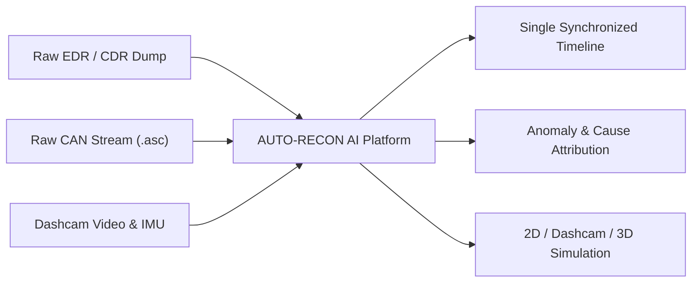
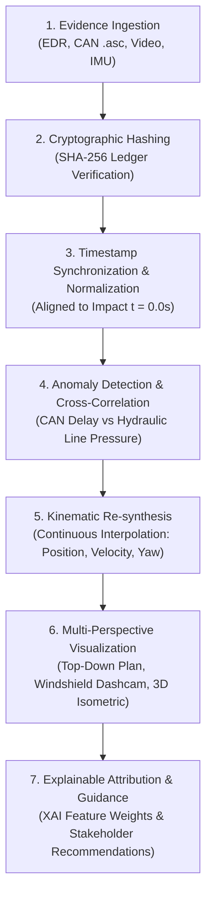

# AI-Driven Incident Reconstruction for Automotive Digital Forensics (AUTO-RECON AI)

**College Capstone Project Presentation**  
**Department:** Computer Science & Engineering / Cybersecurity  
**Team Members:**
1. **Srivatsa M.**
2. **Chandra Shekar Rao P.**
3. **Kanishka Mishra**

---

## Slide 1: Title Slide

### **AUTO-RECON AI**
#### **AI-Driven Incident Reconstruction for Automotive Digital Forensics**

- **Project Domain:** Automotive Cybersecurity & Digital Forensics
- **Platform Type:** Centralized Web-Based Forensic Analysis & Incident Reconstruction System
- **Core Focus:** Multi-source automotive telemetry ingestion, timeline synchronization, anomaly detection, and explainable 2D/3D & dashcam reconstruction
- **Team Members:**
  - Srivatsa M.
  - Chandra Shekar Rao P.
  - Kanishka Mishra

```
+--------------------------------------------------------------------------+
|                              AUTO-RECON AI                               |
|        AI-Driven Incident Reconstruction for Automotive Forensics        |
|                                                                          |
|   [ EDR Data ]   [ CAN Bus Logs ]   [ Sensor Feeds ]   [ Dashcam Video ] |
|         \               |                  |                 /           |
|          +--------------+------------------+----------------+            |
|                                 |                                        |
|                     [ Unified Forensic Studio ]                          |
+--------------------------------------------------------------------------+
```

> **Presenter Speaking Notes:**  
> "Good morning, respected professors and evaluators. Today, our team—Srivatsa M., Chandra Shekar Rao P., and Kanishka Mishra—presents **AUTO-RECON AI**: an AI-driven digital forensics and incident reconstruction platform designed for modern connected and autonomous vehicles."

---

## Slide 2: Aim & Problem Statement

### **Problem Statement & Motivation**
- **Siloed Digital Evidence:** Modern vehicles record gigabytes of data during a crash, but Event Data Recorder (EDR), CAN bus logs, ECU fault codes, and dashcam videos are trapped in proprietary, disconnected formats.
- **Clock Drift & Desynchronization:** ECUs sample at varying clock rates (10 Hz to 1000 Hz) without a unified master clock, making manual chronological reconstruction inaccurate.
- **Hidden Network & Electronic Anomalies:** Critical pre-impact failures (such as CAN arbitration delays or sensor spoofing) are easily obscured without automated correlation against physical vehicle kinematics.

### **Project Aim**
- Develop a **centralized automotive digital forensics workstation** that ingests multi-source vehicle evidence.
- Establish a **cryptographically verified, synchronized incident timeline** across EDR, CAN, sensors, and video.
- Deliver **explainable AI-assisted reconstruction** with continuous 2D top-view, driver dashcam, and 3D isometric visualizations.



> **Presenter Speaking Notes:**  
> "In traditional crash investigations, physical tire marks and crush profiles tell only half the story. The digital story is scattered across CAN logs, EDR EEPROMs, and video. Our aim with AUTO-RECON AI is to bring all heterogeneous evidence into one synchronized environment, detect anomalies, and reconstruct the incident deterministically."

---

## Slide 3: Tech Stack

### **Implemented Technologies & Architecture**

| Layer | Implemented Technologies | Function in AUTO-RECON AI |
| :--- | :--- | :--- |
| **Frontend & UI** | HTML5, CSS3, Tailwind CSS (Utility-First), FontAwesome | Responsive forensic dashboard, high-contrast forensic cards, executive mode |
| **Simulation Engine** | HTML5 Canvas 2D API, Custom Matrix Transformation Engine | Real-time continuous trajectory simulation (Top View, Dashcam forward view, 3D Isometric) |
| **Telemetry & Analytics** | Chart.js, Vanilla ES6+ Math & Interpolation Routines | Telemetry line charts (Speed, Throttle, Brake Bar, Steer Angle, CAN Bus Load) |
| **Integrity & Security** | Web Crypto API (`crypto.subtle.digest`) | Client-side SHA-256 evidence hashing, immutable forensic ledger, chain of custody |
| **Data Processing** | Python (Automated inspection scripts), JSON-based forensic schema | Structured parsing of EDR parameters, CAN arbitration IDs, and milestone objects |
| **Evidence Formats Handled** | `.bin` (EDR dump), `.asc` (CAN log), `.mp4` (Dashcam stream), `.log` (IMU/GPS) | Normalized into standardized timestamped kinematic objects (`[-5.0s, +2.5s]`) |
| **Explainable AI (XAI)** | Mathematical Feature Contribution Engine (TreeSHAP-style weights) | Calculates percentage weight of braking latency, throttle spikes, or sensor conflicts |

*(Note: Full end-to-end cloud backend and physical hardware OBD-II capture are designed as future expansion modules).*

> **Presenter Speaking Notes:**  
> "Our architecture is intentionally lightweight, portable, and dependency-free. We use modern web technologies with the Canvas 2D API for continuous simulation, Chart.js for live sensor telemetry, Web Crypto API for SHA-256 chain-of-custody verification, and Python for data normalization."

---

## Slide 4: Methodology & Pipeline

### **End-to-End Forensic Reconstruction Pipeline**



### **Core Pipeline Highlights**
1. **Time Zero Alignment:** All disparate event clocks are calibrated relative to the primary deceleration pulse impact point ($t = 0.00\text{s}$).
2. **Cross-Domain Correlation:** The system verifies physical driver actions (brake switch) against network transmissions (CAN ID arbitration) to identify lag or electronic fault.
3. **Deterministic Continuous Simulation:** Telemetry values are linearly interpolated to produce continuous rendering across all camera viewports.

> **Presenter Speaking Notes:**  
> "Our methodology follows strict forensic science principles: ingest evidence, record cryptographic SHA-256 hashes to guarantee chain of custody, normalize all clocks relative to impact time zero, detect telemetry anomalies, and generate synchronized multi-perspective visual reconstructions."

---

## Slide 5: System Architecture & Working

### **How Evidence Flows into Forensic Findings**

```
+-----------------------------------------------------------------------------------+
|                            EVIDENCE INGESTION LAYER                               |
|   EDR Partition (.bin)  |  CAN Stream (.asc)  |  Dashcam (.mp4)  |  IMU Data (.log) |
+-----------------------------------------+-----------------------------------------+
                                          |
                                          v
+-----------------------------------------------------------------------------------+
|                     NORMALIZATION & TIME-ALIGNMENT ENGINE                         |
|   - Cryptographic SHA-256 Checksum Calculation                                    |
|   - Impact Calibration (t = 0.00s Anchor)                                         |
|   - Continuous Hermite/Linear Kinematic Interpolator                              |
+-----------------------------------------+-----------------------------------------+
                                          |
                                          v
+-----------------------------------------------------------------------------------+
|                        CROSS-CORRELATION & XAI ANALYZER                           |
|   - CAN Message Starvation Check    - Sensor Plausibility (Radar vs Camera)       |
|   - Hydraulic Rise Latency Metric   - Explainable Feature Attribution (TreeSHAP)  |
+-----------------------------------------+-----------------------------------------+
                                          |
                                          v
+-----------------------------------------------------------------------------------+
|                       INTERACTIVE FORENSIC RECONSTRUCTION                         |
|   [ Top-Down Plan View ]    |    [ Driver Dashcam View ]    |  [ 3D Isometric View ]  |
|   - Intersection / Ramps    |    - Perspective Road / HUD   |  - 3D Extruded Bodies   |
|   - Dynamic Pedestrians     |    - Glare / Weather / Hazard |  - Elevation & Depth    |
+-----------------------------------------------------------------------------------+
```

- **Independent Clocks Eliminated:** All camera modes query one unified physics clock (`getScenarioKinematics`), preventing view desynchronization.
- **Evidence Cross-Verification:** Demonstrates whether driver input preceded or followed vehicle response.

> **Presenter Speaking Notes:**  
> "This architecture ensures that what you see in the Top View matches the driver's perspective in Dashcam and the depth in 3D Isometric. If the driver braked at minus 3.1 seconds, the brake lights, HUD Bar pressure, and top-down skidmarks all respond simultaneously."

---

## Slide 6: Results & Demonstration Scenarios

### **Working Prototype Capabilities**
- **7 Validated Reconstruction Benchmarks** spanning vehicle fault, driver fault, road defect, and environmental scenarios.
- **Multi-Perspective Visual Verification:** Seamless switching between Top View, Driver Windshield Dashcam, and 3D Isometric mode without resetting timeline state.
- **Interactive Scrubber & Playback:** Variable playback speeds (0.5x, 1x, 2x, 5x) with millisecond-accurate timeline scrubbing.

### **Key Reconstructed Forensic Scenarios**
1. **Urban Intersection (`AF-8902`):** Identifies a 2.1-second CAN gateway arbitration delay between pedal depression ($t = -3.1\text{s}$) and brake actuator pressure rise ($t = -1.0\text{s}$).
2. **Highway Exit Gore Point (`AF-4421`):** Reconstructs pedal misapplication (throttle pinned at 99%) causing acceleration to 117 km/h into a crash cushion attenuator.
3. **Construction Zone Diversion (`AF-6715`):** Demonstrates ADAS lane-centering vision decay and late driver takeover warning before a barrier strike.
4. **Pedestrian Crosswalk (`AF-1082`):** **Dynamic pedestrian animation** where both the vehicle and the walking pedestrian move continuously along physical timelines before impact, explaining camera glare AEB suppression.
5. **Expressway Multi-Pileup (`AF-5503`):** Reconstructs hydroplaning in rain (-0.42g decel limit) combined with cabin driver distraction.
6. **Steering System Failure (`AF-9104`):** Visualizes steering angle sensor sign inversion leading to unintended ESC asymmetrical braking, progressive lane deviation, and rollover.
7. **Mountain Runaway Truck Ramp (`AF-3389`):** Reconstructs pneumatic brake fade on an 8% downgrade and successful arrest in a loose gravel escape bed.

> **Presenter Speaking Notes:**  
> "Our prototype demonstrates all 7 critical forensic scenarios. Notice that in the pedestrian crosswalk scenario, the pedestrian naturally walks across the crosswalk stripes into the headlights beam while the car approaches, proving both objects were dynamic prior to impact."

---

## Slide 7: Recommendations & Future Scope

### **Bridging Academic Prototype to Field Deployment**
- **Hardware-in-the-Loop (HIL) Adapter:** Integrate direct physical extraction hardware (CAN-to-USB / Vector CANoe interfaces) for real-time ECU readouts.
- **OEM Proprietary Decoder Library:** Expand support for manufacturer-specific EDR binary schemas (Bosch CDR, Toyota, Tesla proprietary CAN databases).
- **Deep-Learning Video Kinematics:** Implement optical flow and YOLOv8-based vehicle pose estimation to automatically extract telemetry directly from raw dashcam video files.
- **Standardized Forensic Compliance:** Align report generation with ISO/IEC 27037 (Digital Evidence Handling) and ASTM E30.12 (Vehicle Incident Forensics).
- **Immutable Blockchain Ledger:** Upgrade client-side SHA-256 hashing to a consortium blockchain network for multi-agency evidence chain of custody.

```
[ Current Prototype ] ------------> [ Future Commercial Architecture ]
- Web-based Simulation               - Hardware OBD-II / CDR Streamer
- Standard Normalized Schema          - Automated OEM DBC / A2L Decoders
- SHA-256 Ledger Table                - ISO/IEC 27037 Compliance Export
- Canvas 2D / 3D Isometric View      - Unreal Engine / WebGPU 3D Re-synthesis
```

> **Presenter Speaking Notes:**  
> "While our current prototype successfully correlates synthesized EDR and CAN logs with continuous visual playback, future work will focus on integrating raw DBC decoder files, expanding real-time hardware acquisition tools, and complying with international standards like ISO 27037."

---

## Slide 8: Conclusion

### **Project Summary & Contribution**
- **Overcoming Siloed Investigations:** AUTO-RECON AI successfully demonstrates that multi-source automotive digital evidence can be unified into a single synchronized timeline.
- **Root Cause Attribution:** By correlating electronic bus data (CAN) with mechanical telemetry (EDR/IMU), the system distinguishes between driver fault, electronic actuator latency, and environmental interference.
- **Investigator-Centric Clarity:** Multi-camera visualizations (Top View, Dashcam, 3D) paired with explainable AI feature weights provide transparent, courtroom-ready forensic summaries.
- **Practical Impact:** Significantly accelerates the digital forensics workflow for accident reconstruction specialists, insurance investigators, and vehicle safety regulators.

```
"Turning fragmented vehicle logs into explainable, defensible truth."
```

### **Thank You!**
**Questions & Technical Discussion**

---

### Team Contact & Details
- **Srivatsa M.**
- **Chandra Shekar Rao P.**
- **Kanishka Mishra**
- **Project Repository / Working Build:** AUTO-RECON AI Workstation
